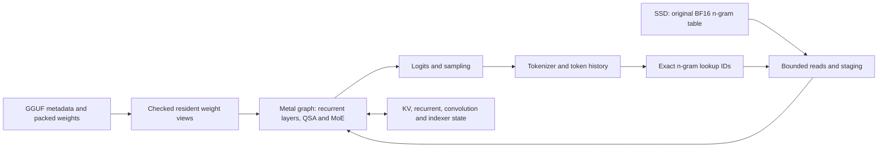

# Large-model direction: a 64 GiB Metal inference engine

Research date: 2026-10-11. Intended workload: coding and general reasoning.
Status: model recommendation and engineering plan, before model-backed local
validation. External measurements below have not been reproduced on this Mac.

**User decision:** proceed with **Qwen3.8-Flash-Next Q2**. The 80B discussion
was an alternative assessment, not a replacement for the selected target.
Use the [new-session handoff](qwen38-q2-session-prompt.md) to begin execution
with the feasibility baseline and then the native C11/Metal implementation.

Follow-up: the user's proposed **80–100B class** is evaluated separately in
[the 80–100B comparison](80b-100b-model-comparison-2026-10-11.md). Within that
constraint, Qwen3-Coder-Next and Qwen3-Next-80B-A3B-Thinking at 4 bits are the
recommended first comparisons. The larger-model recommendation below records
the original, broader search; it is not a requirement to choose a model above
100B.

## Decision

Make **Qwen3.8-Flash-Next** the primary feasibility target, using calibrated
low-bit routed experts, resident main weights and disk-only original n-gram
embeddings. Start with the exact Q2 artifact supported by DwarfStar. Validate
its quality and memory first, then build the corresponding C11/Metal path in
picoforge. Qwen3-30B-A3B remains a regression and kernel-development fixture.

Use **Qwen3.5-122B-A10B, UD-IQ3_S** as the alternative when a fully resident
model is preferable or the Qwen3.8 quality/complexity trade-off fails. Its
published checkpoint is 43.36 GiB, before runtime allocations. Keep
Qwen3-Coder-Next Q4_K_M as a coding-focused comparison.

This recommendation is conditional on useful task performance after
compression. Parameter count and original-model leaderboard scores do not
establish the quality of a local Q2 checkpoint. There is no demonstrated
picoforge advantage over DwarfStar, llama.cpp or MLX-LM yet.

The new objective is **better useful model capability within this Mac's
memory and latency limits**. It supersedes the earlier release restriction
against SSD offload and the priority given to further 30B draft scheduling.

## Evidence and machine budget

There are three different kinds of numbers in this document:

- **Observed locally:** hardware/API limits, installed SDK, available storage.
- **Published upstream:** checkpoint bytes, model specifications and benchmarks.
- **Proposed:** memory policies, acceptance gates and optimizations to test.

A small Objective-C probe queried `MTLCreateSystemDefaultDevice()` without
loading model weights:

| Item | Observed value |
|---|---:|
| Device | Apple M5 Pro, unified memory |
| Physical memory | 68,719,476,736 bytes = 64.00 GiB |
| `recommendedMaxWorkingSetSize` | 51.84 GiB |
| `maxBufferLength` | 38.88 GiB |
| `maxThreadgroupMemoryLength` | 32 KiB |
| macOS | 27.0.1, build 26A434 |
| Selected macOS SDK | 26.5 |
| Metal compiler | 32023.883 |
| Available space on workspace volume | approximately 215 GiB at inspection |

The recommended Metal working set is guidance, not a second physical RAM
capacity. The single-buffer limit is also separate: multiple correctly
managed buffers can address a model larger than 38.88 GiB. None of these
numbers justifies consuming all 64 GiB or relying on system swap.

Proposed initial policy: aim for **48–50 GiB peak application working set**,
including weights, state, workspaces and I/O staging; admit a request against
the current device budget. Start with one session and 8K total context,
then validate 16K and 32K for repository work. The final budget must follow
measured physical footprint, Metal allocations, pressure and swap growth;
`ru_maxrss` alone misses relevant GPU-backed mappings.

## Candidate comparison

These are checkpoint sizes, **not total runtime memory**. GiB means 2^30
bytes. Different quantization labels can contain different precision mixes.

| Candidate | Parameters / active parameters | Concrete compressed artifact | Assessment for this machine |
|---|---|---|---|
| **Qwen3.8-Flash-Next** | 125B backbone / 6B active, plus 51B n-gram embeddings and 4B MTP | DwarfStar Q2: 41.73 GiB main/MTP + 95.37 GiB disk-only tables; 137.10 GiB file | Primary candidate; main inference fits the documented budget with selective SSD lookup; substantial new architecture |
| **Qwen3.5-122B-A10B** | 122B / 10B | Unsloth UD-IQ3_S: 43.36 GiB; UD-IQ3_XXS: 41.67 GiB | Strong fully resident alternative; still requires a hybrid-attention engine and quality validation |
| **Qwen3-Coder-Next** | 80B / 3B | Unsloth Q4_K_M: 45.20 GiB | Less aggressive compression, coding-oriented; less ambitious as the general-reasoning target |
| **DeepSeek V4 Flash 0731** | 284B / 13B | DwarfStar Q2: about 81 GiB | Needs expert streaming on 64 GiB; useful later, but SSD misses become a central latency risk |
| **GLM-5.3-Flash** | 320B / 18B | DwarfStar Q2: about 90 GiB | Even larger residency deficit; not the first implementation target |

Specifications: [Qwen3.8][qwen38], [Qwen3.5][qwen35],
[Coder-Next][coder], [GLM][glm]. Artifact sources:
[DwarfStar Qwen releases][qwen-quants], [DwarfStar model guide][ds4-models],
[Unsloth 122B][qwen35-quants], [Unsloth Coder-Next][coder-quants].
Unsloth file totals were summed from Hugging Face artifact metadata, including
all parts of split GGUFs; revisions are recorded below.

The 122B illustrates why `parameters × bits / 8` is only a lower-level
estimate: its published Q3_K_M is **52.55 GiB**, and Q4_K_M is **71.28 GiB**.
The actual tensor mix, block metadata and padding determine fit. The
43.36 GiB alternative refers specifically to UD-IQ3_S.

Qwen's Qwen3.8 model card reports 62.5 on SWE-bench Pro and 91.7 on GPQA
Diamond. These are vendor-reported original-model results with documented
harness choices, not local Q2 scores or proof of parity with current frontier
systems. They motivate testing this candidate for both requested workloads.
[Source and evaluation conditions][qwen38]

A modern smaller model at higher precision should remain a **quality
comparator**, even though it is not the new project's target. If aggressive
compression removes the larger model's practical advantage, fitting more
parameters is not a successful outcome.

## Why Qwen3.8 is feasible, and what “fits” means

The backbone uses a hybrid recurrent/sparse-attention design. Its additional
n-gram capacity is accessed by token-derived lookup indices, which can be
known before the relevant hidden-state computation. This makes selective
lookup qualitatively different from predicting future MoE routes.
[Architecture report, sections 2.1–2.3][qwen-paper]

The proposed configuration keeps the quantized backbone in unified memory
and reads selected original BF16 n-gram rows from the SSD. It therefore
**does not put the whole logical model in RAM**. It avoids streaming large
expert matrices in the initial configuration. DwarfStar does not currently
implement SSD expert streaming for its Qwen3.8 path; its generic streaming
flag must not be assumed to work for this model. [Qwen runtime guide][ds4-qwen]

DwarfStar reports a planned allocation of **42.86 GiB at 8K context with a
1,024-token prefill chunk** for Q2. That is a promising fit against our
51.84 GiB recommendation, but an allocation plan is not measured peak physical
memory. Its indicative M5 Max run reports 48.7 decode tokens/s at 32K; this is
one external run on different hardware, not a speed forecast for our M5 Pro.
[Upstream QA reference][ds4-qa]

Storage matters too. The selected file is 137.10 GiB. With roughly 215 GiB
available now, one copy leaves about 78 GiB. Keeping both complete Q2 and Q4
packages, or the full original BF16 source plus converted output, does not
fit that allowance. Begin with a published, pinned artifact; later conversion
must process source shards incrementally with bounded RAM and explicit
temporary-disk accounting, or use separate storage. Do not create another
full checkpoint merely to change container layout.

## What to take from DwarfStar

The source inspection used commit
`fc80bd695da76ee14bcb86820bf900a5cdfda806`, rather than an unspecified future
`main`. Useful implementation details:

| Source | Applicable lesson |
|---|---|
| [`ds4_metal.m`, model mapping][ds4-metal] | A few page-aligned, overlapping no-copy views; each tensor fits wholly inside one view, avoiding a single giant buffer |
| [`metal/qwen4.metal`][ds4-kernels] | Explicit kernels for recurrent attention, gated residuals, n-gram operations, routing and different expert workloads |
| [`gguf-tools/README.md`][ds4-quant-tools] | Calibration and per-projection precision choices; the Q2 down projection has 640 logical inputs padded to 768 |
| [`ds4_ssd.c`][ds4-ssd-code] | Budget the expert cache after mandatory resident allocations; relevant to later expert-streaming experiments |
| [Quality-testing implementation][ds4-quality] | Separate implementation correctness from compression loss; hosted continuations are useful evidence but not an exact pinned-checkpoint oracle |

The design can inform picoforge without turning it into a wrapper around
DwarfStar. Keep the inference engine in C11 with a narrow Objective-C Metal
boundary. If source fragments are reused later, preserve their upstream
license notices and provenance. Support one selected model path well before
generalizing it into a framework.

## Compression strategy

### Establish a calibrated baseline

Start with the exact mixed-precision recipe in the selected artifact:
IQ2_XXS routed gate/up, Q2_K routed down, and the existing higher-precision
dense/control tensors. Preserve original n-gram values. Measure before
altering the recipe. “Q2” does not mean every tensor is two-bit, nor is
IQ2_XXS equivalent to a native signed INT2 tensor. [Artifact provenance][qwen-quants]

Our present symmetric Q8/Q4 weight-only converter is insufficient for this
target. Calibration must include code, reasoning, Italian/English prompts,
tool schemas and realistic context lengths. Freeze separate calibration and
evaluation sets. Track expert coverage; a rarely visited expert must not be
treated as unimportant merely because a small corpus missed it.

Measure sensitivity by layer and projection, then spend available bytes on
the tensors whose higher precision improves held-out tasks most. Candidate
upgrades include sensitive down projections, selected routed layers, shared
experts and output projections. Preserve router, normalization and recurrent
state precision initially. Fit the **actual layout bytes** to a measured
budget, including MTP and padding.

Regenerate new quantizations from original weights. Requantizing an already
compressed checkpoint cannot recover information discarded earlier.

### Techniques researched and their role

| Technique | What the paper establishes | Decision for picoforge |
|---|---|---|
| [AWQ][awq] | Activation statistics can guide channel scaling for weight-only quantization | A practical candidate for improving 4-bit paths; evaluate calibration and folding with our graph |
| [GPTQv2][gptq2] | Layer calibration can account for error accumulated from earlier quantized layers without fine-tuning | Candidate offline 2–4-bit quality experiment after an end-to-end baseline; output format still needs matching Metal kernels |
| [QuIP#][quip] | Hadamard incoherence and lattice codebooks support extreme weight compression, with fine-tuning improving fidelity | Research branch; rotations, codebooks and calibration costs need an explicit Metal implementation and quality study |
| [AQLM][aqlm] | Additive codebooks offer strong compression at low bit rates | Research branch; additive lookup cost and training/calibration requirements may offset bandwidth savings |
| [KIVI][kivi] | Keys and values benefit from different quantization groupings | Consider for attention caches after an FP16/BF16 reference passes; not a recipe for recurrent-state quantization |
| [TurboQuant][turboquant] | Rotation-based online vector compression gives favorable KV rate/distortion results on evaluated workloads | Later KV experiment; does not solve backbone weight residency or establish correctness for this model's recurrent/sparse state |
| [LLM in a flash][flash-ssd] | Selective reads, reuse windows and storage layout can reduce flash traffic | Useful I/O principles; its activation-sparsity assumptions and reported speedups do not transfer automatically to Qwen |
| [MoE-Infinity][moe-infinity] | Trace-informed expert caching and prefetch can help constrained personal systems | Later expert-streaming design; CPU/GPU PCIe results are not Apple unified-memory measurements |

No single method is universally best. Select using downstream quality,
effective bits, decode time, prefill time, conversion cost and memory peak.
Pruning experts or n-gram tables, changing top-k, and reducing layers alter
the model; they are separate lossy experiments, not baseline correctness
optimizations. QAT/distillation is also a separate training project.

## Metal implementation priorities

### 1. Replace the single-buffer storage assumption

Introduce a checked weight view containing a buffer identifier, byte offset,
logical shape and quantization layout. Map only resident tensor ranges into
Metal. Use a small number of stable views or per-layer arenas, with explicit
page alignment and lifetime ownership. Verify tensors at view boundaries,
overflow checks and shard ownership.

This removes the present `st->map`/one-buffer limitation in
`src/gpu_forward.m`; it does not increase physical memory. The source
checkpoint can stay GGUF for reproducibility: add a narrow reader for the
chosen architecture and formats, keeping the current safetensors path for
regression fixtures.

### 2. Separate decode and prefill kernel selection

Decode normally has few rows per expert: benchmark dedicated SIMD GEMV,
packed low-bit loads and fused gate/up/activation against TensorOps. Prefill
and sufficiently large expert groups can use Metal 4 MPP matrix operations
and the M5 GPU Neural Accelerators. Select by actual shape and routed token
count. A nominally faster matrix engine can lose on a nearly empty tile.

The [BaseRT M5 paper][basert] supports this workload distinction and describes
fused expert work and attention. Its speedups apply to its measured models
and setup, not to our proposed 125B backbone.

### 3. Keep dequantization inside the useful computation

Decode from packed weights in the GEMV kernel. For prefill, compare direct
supported quantized tensors with custom decoding into registers/cooperative
tensors or small threadgroup tiles. Never expand the whole model to FP16.
Measure lookup tables, padding, register pressure and occupancy alongside
arithmetic throughput.

Apple's [WWDC26 TensorOps session][apple-tensors] documents native integer
and floating quantized formats, scale planes and cooperative-tensor inputs.
Our selected SDK 26.5 exposes INT4 but lacks the newer host INT2/FP4 tensor
declarations. macOS 27 being installed does not prove the build can use every
new API. Compile and run numerical probes with the actual toolchain before
choosing a format or requiring an SDK upgrade. New native INT2 support would
still not directly decode an IQ2_XXS codebook.

### 4. Implement the actual hybrid graph

Qwen3.8 is not accepted by the current `qwen3`/`qwen3_moe` parser and cannot
be added by changing a model name. Required work includes Gated DeltaNet,
causal convolution, QSA indexing and sparse attention, four-branch gated
residuals, shared experts, n-gram gates/convolution, its tokenizer/template
and later the dedicated MTP block. [Official config][qwen-config]

Use tiled online-softmax attention instead of storing a context-sized score
array in threadgroup memory. Preserve QSA's specified selection and causality;
FlashAttention-style tiling does not authorize replacing sparse attention with
a different algorithm. Start recurrent accumulation in FP32 and assess reduced
precision only with long-sequence and continuation tests. [FlashAttention][fa]

### 5. Make n-gram I/O bounded and overlap it where possible

Keep the 95.37 GiB table outside whole-model mappings, weight warming and
Metal residency. Derive exact lookup IDs from token history on the CPU;
coalesce/deduplicate reads and stage only the requested rows into bounded
shared buffers. A small measured row cache can reduce repeat reads. During
prefill the known prompt permits lookahead; generation can overlap the next
required lookup with work before the lookup layer.

Account for read latency and system file-cache pressure, not only sequential
SSD bandwidth. Read errors must stop the affected inference and invalidate
state, rather than reuse stale rows. Future expert prefetch differs: routes
depend on hidden states; speculation must never skip an actually selected
expert or change the router result.

### 6. Reduce allocation, dispatch and state replay costs

Allocate reusable workspaces, pipeline objects and bindings before steady
decode. Keep routing/grouping on GPU where possible. Profile fusion of
normalization, projections, gate/up and residual operations. Add a resident
session with correct prompt-prefix reuse so repeated coding turns do not
restart the whole engine.

MTP is later: validate accepted and rejected branches against ordinary decode,
including recurrent, convolution, indexer and n-gram state. Rolling back KV
length alone is insufficient. Greedy speculation must meet picoforge's
ordinary-greedy parity rule; sampled speculation needs the correct acceptance
scheme or an ordinary-sampling fallback. DwarfStar's opportunistic defaults
are not automatically our correctness contract.

The M5 GPU Neural Accelerators are distinct from the Apple Neural Engine.
This plan uses Metal/MPP; it does not require an ANE/Core ML detour.

## Proposed data flow

This is the planned graph, not current picoforge functionality.

## Validation and acceptance

Separate three questions explicitly:

1. **Implementation:** CPU oracle versus Metal using the *same* weights;
   tokenization, layer outputs, logits, routing and state transitions.
2. **Compression:** candidate quantization versus pinned higher-precision
   reference where feasible; held-out NLL and task scores. An oracle using
   dequantized Q2 weights proves no original-model quality claim.
3. **Usefulness:** compressed large model versus a strong smaller local model
   on the actual coding and reasoning workload at matched time/token budgets.

For the large high-precision reference, use layer/tensor fixtures and bounded
CPU execution or separately recorded pinned logits; full GPU residency is
not required for every correctness check. A hosted endpoint is only an
additional quality reference. It cannot prove equivalence to the downloadable
checkpoint, and this study made no paid inference calls.

Build a fixed evaluation manifest with:

- Coding: a dated [LiveCodeBench][lcb] subset, [EvalPlus][evalplus] as a quick
  regression set, and held-out repository bug fixes graded by tests. Keep
  task prompts out of calibration. Record scaffold, reasoning budget and
  timeouts; a small subset does not inherit an official leaderboard score.
- Reasoning: a frozen collection of difficult math/logic problems with
  checkable answers, instruction following and Italian/English tasks. Include
  long-form reasoning, not only next-token agreement on short prose.
- Context/state: 8K, 16K and 32K retrieval, correction turns, prompt appends,
  save/restore and rewind; recurrent-state tests must cross chunk boundaries.
- Performance: cold load, first prefill, warm prefill, continued prefill,
  time to first token, decode, full request time, peak memory, swap delta,
  SSD bytes/read latency and thermal state. Test ordinary decode before MTP.

Use DwarfStar with the exact selected artifact as the first performance
baseline. Add llama.cpp/MLX-LM only with confirmed support and documented
tensor/quantization equivalence; different packing or precision requires
quality-matched comparison rather than an unqualified speed ratio.

Proposed gates, to freeze before experiments:

| Gate | Required evidence |
|---|---|
| Feasibility | One local session, initially 8K, within the measured memory policy without sustained swap-driven decoding |
| Quality | Held-out task results justify the larger compressed model; report paired differences and uncertainty rather than a few attractive responses |
| Correctness | Independent primitive/graph/state checks; complete ordinary-greedy parity for any speculative mode advertised as lossless |
| Interactive utility | Initial engineering floor of 10 decode tokens/s and 8K prefill within 60 s, excluding cold load; targets, not predictions, with p10/p90 reported |
| Optimization | A measured end-to-end benefit at unchanged quality and fit; no acceptance based only on a microbenchmark |

For performance decisions follow the existing `docs/BENCHMARKS.md` protocol:
warmups, randomized order, 25 repetitions where practical, raw timings and
source/checkpoint hashes. Short exploratory runs remain labelled pilots.
Task-quality confidence intervals must use tasks as the sampling unit; timing
repetitions do not create additional independent quality examples.

## Work order and decision points

| Step | Deliverable | Exit condition |
|---|---|---|
| 0. Feasibility baseline | Pinned DwarfStar Q2 run on this Mac, exact memory and quality manifest | Validate fit and usefulness before committing to the full new graph |
| 1. Weight storage | Multiple Metal views, explicit memory accounting, narrow GGUF reader | Existing Qwen3 regression path passes; offsets and formats validated |
| 2. Independent hybrid reference | Tiny synthetic Qwen3.8-shaped graph, tokenizer fixtures, selected real layer references | Reference agrees with the model implementation on supported operations |
| 3. Complete Metal graph | Ordinary generation with resident low-bit experts and bounded n-gram reads | End-to-end/state parity and actual memory fit |
| 4. Compression/precision sweep | Calibrated mixed-precision variants within the same memory budget | Best held-out quality/latency trade-off, with conversion costs recorded |
| 5. M5 optimization | Decode GEMV, grouped prefill MPP, fusion, prefix reuse | Measurable request-level improvements |
| 6. Longer context and MTP | Cache experiments and complete state rollback | Quality and correctness retained, acceptance overhead included |
| 7. Optional larger models | Expert cache, read scheduling and prefetch for DeepSeek/GLM | Only after SSD traffic estimates and pilot traces support useful latency |

If Qwen3.8's compressed quality or implementation cost is unacceptable, take
the 122B fully resident alternative without discarding the storage, hybrid
reference, low-bit and Metal profiling work. Exact kernels and graph code
will still differ between model families.

Revisit the choice after actual Q2 task results, a new suitable model release,
a change in available memory/storage, or evidence that the SSD lookup path
dominates latency. Do not claim the optimal model or kernel has been found
from literature alone.

## Reproducibility and current limits

| Artifact | Pinned revision |
|---|---|
| picoforge inspected HEAD | `a88e4639fc517f8276801f646b3f731b0145d158` plus existing local work |
| antirez/ds4 | `fc80bd695da76ee14bcb86820bf900a5cdfda806` |
| Qwen/Qwen3.8-Flash-Next | `de4b8e4d43b917e7706784d8bb445c9af86a3540` |
| antirez/qwen3.8-flash-next-gguf | `d600fe1a43d2e1cdcadb85144ce3142f66f9eefe` |
| Qwen/Qwen3.5-122B-A10B | `dc4d348443bc740c68e2d77492492c11606384d5` |
| unsloth/Qwen3.5-122B-A10B-GGUF | `51eab4d59d53f573fb9206cb3ce613f1d0aa392b` |
| Qwen/Qwen3-Coder-Next | `a7fbcb5c0e12d62a448eaa0e260346bf5dcc0feb` |
| unsloth/Qwen3-Coder-Next-GGUF | `ce09c67b53bc8739eef83fe67b2f5d293c270632` |

Hugging Face publishes SHA-256
`b1b93fa69aca5f187b0fb813aca8f3ec1beb5cf8cf0bd38cf041b93e0b6ccac9`
for `Qwen3.8-Flash-Next-Q2.gguf`. This was read from artifact metadata,
not verified against a downloaded weight file in this research pass.

The Qwen3.8 weights have a Qwen Community License; the two older Qwen
alternatives list Apache-2.0. Runtime and weight licensing are separate.

Completed here: primary-source research, source inspection, checkpoint
metadata checks and a local Metal capability probe. No new model weights
were downloaded, inference engines installed, or model-quality/throughput
benchmarks executed. The architecture remains to be implemented. Existing
uncommitted engine/UI experiments were preserved.

[qwen38]: https://huggingface.co/Qwen/Qwen3.8-Flash-Next
[qwen35]: https://huggingface.co/Qwen/Qwen3.5-122B-A10B
[coder]: https://huggingface.co/Qwen/Qwen3-Coder-Next
[glm]: https://huggingface.co/zai-org/GLM-5.3-Flash
[qwen-quants]: https://huggingface.co/antirez/qwen3.8-flash-next-gguf/tree/d600fe1a43d2e1cdcadb85144ce3142f66f9eefe
[qwen35-quants]: https://huggingface.co/unsloth/Qwen3.5-122B-A10B-GGUF/tree/51eab4d59d53f573fb9206cb3ce613f1d0aa392b
[coder-quants]: https://huggingface.co/unsloth/Qwen3-Coder-Next-GGUF/tree/ce09c67b53bc8739eef83fe67b2f5d293c270632
[qwen-paper]: https://arxiv.org/html/2608.30320v1
[qwen-config]: https://huggingface.co/Qwen/Qwen3.8-Flash-Next/blob/de4b8e4d43b917e7706784d8bb445c9af86a3540/config.json
[ds4-models]: https://github.com/antirez/ds4/blob/fc80bd695da76ee14bcb86820bf900a5cdfda806/docs/MODELS.md
[ds4-qwen]: https://github.com/antirez/ds4/blob/fc80bd695da76ee14bcb86820bf900a5cdfda806/docs/QWEN38_FLASH_NEXT.md
[ds4-qa]: https://github.com/antirez/ds4/blob/fc80bd695da76ee14bcb86820bf900a5cdfda806/QA_BEFORE_RELEASES.md#qwen-quality-and-speed-references
[ds4-metal]: https://github.com/antirez/ds4/blob/fc80bd695da76ee14bcb86820bf900a5cdfda806/ds4_metal.m#L2199
[ds4-kernels]: https://github.com/antirez/ds4/blob/fc80bd695da76ee14bcb86820bf900a5cdfda806/metal/qwen4.metal
[ds4-ssd-code]: https://github.com/antirez/ds4/blob/fc80bd695da76ee14bcb86820bf900a5cdfda806/ds4_ssd.c
[ds4-quant-tools]: https://github.com/antirez/ds4/blob/fc80bd695da76ee14bcb86820bf900a5cdfda806/gguf-tools/README.md
[ds4-quality]: https://github.com/antirez/ds4/blob/fc80bd695da76ee14bcb86820bf900a5cdfda806/gguf-tools/quality-testing/README.md
[awq]: https://arxiv.org/abs/2306.00978
[gptq2]: https://arxiv.org/html/2504.02692v2
[quip]: https://arxiv.org/abs/2402.04396
[aqlm]: https://arxiv.org/html/2401.06118v3
[kivi]: https://arxiv.org/abs/2402.02750
[turboquant]: https://arxiv.org/abs/2504.19874
[flash-ssd]: https://arxiv.org/html/2312.11514v3
[moe-infinity]: https://arxiv.org/html/2401.14361v3
[basert]: https://arxiv.org/html/2607.19438v1
[apple-tensors]: https://developer.apple.com/videos/play/wwdc2026/330/
[fa]: https://arxiv.org/abs/2205.14135
[lcb]: https://livecodebench.github.io/
[evalplus]: https://github.com/evalplus/evalplus
