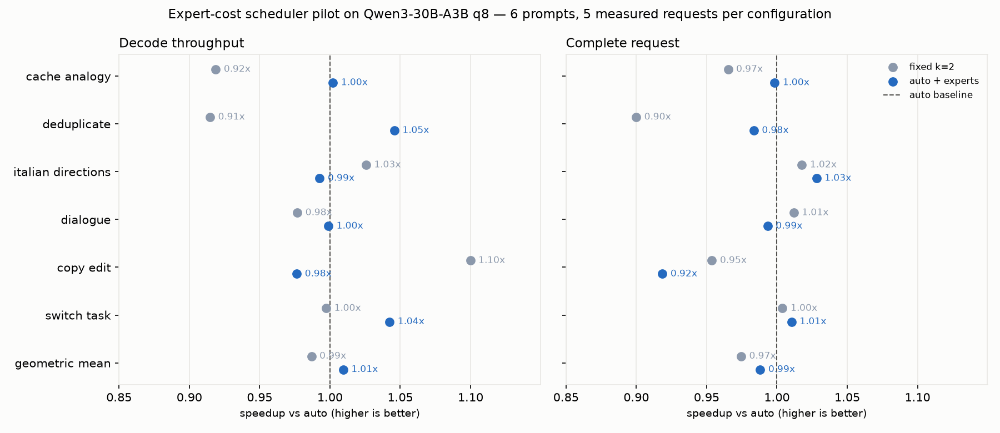

# Phase 4: accepted-route cost experiment

The default scheduler stays unchanged. `auto-experts` is an opt-in experiment,
not a speed claim. It changes only draft length; target logits, greedy
acceptance and cache rollback still decide every output token.

## Hypothesis and implementation

The last 32 accepted input routes may predict how many distinct experts a
future verification will touch. Per layer, count each expert's occurrences
in that window, with one uniform prior token. For a verification of n tokens,
estimate the union as sum(1 - (1 - p_expert)^n). This deliberately simple
independence model can be wrong when routes are correlated or drafts diverge.

Fit verification wall time as a nonnegative intercept plus a nonnegative
coefficient times mean distinct experts per MoE layer. Learn from *all*
verified rows, including rejected drafts, with exponentially decayed samples
(keep 0.95). Require at least four observations with distinct expert counts
that vary; otherwise use the existing scheduler's timing estimates. Only
accepted input rows enter the route history. Nothing from the current verify
may influence its prediction.

The route window, prior, forgetting factor and readiness rule are fixed before
evaluation. Do not tune them on the separate evaluation prompts. GPU route
recording, CPU prediction and updates are included in decode and request time.
Optional per-pass diagnostics retain predictions, actual routes, acceptance
and costs; diagnostic file I/O is also timed, so keep it off in performance
comparisons.

## Validation plan

- CPU unit tests: analytically known expert unions, mixed dense/MoE layers,
  history eviction, rejection isolation, and an independently known linear
  cost function. Flat or insufficient observations must fall back safely.
- Engine integration: exact ordinary-greedy parity with self drafting,
  mismatched drafting, context boundaries and maximum draft length; verify
  diagnostic expert counts from the recorded route sets.
- Existing checks: build with the project's warnings, `make test-all`.
- Performance: randomized request order, discarded warmups, raw timings,
  source/checkpoint hashes, independent greedy reference. Compare `plain`,
  `model-2`, `model-auto`, `model-auto-experts` on separate prompts. Report
  per-prompt regressions, prediction error and overhead, not just an aggregate.
- UI: expose the mode as experimental and exercise it in the local browser.

The review's adoption threshold remains a stable 10% gain over `model-auto`.
A small pilot cannot establish stability. First-use prompt latency remains a
separate work item in the review: these request timings include it and must
not be described as warmed resident-engine timings.

## Results

The six-prompt pilot does **not** meet the 10% adoption threshold. Against the
unchanged `auto` scheduler, the experiment reaches **1.009x decode throughput**
and **0.988x full-process speed** (geometric means of per-prompt median ratios).
It wins decode on three of six prompts; the default remains `auto`.

Qwen3-30B-A3B q8_row, Qwen3-0.6B drafter, context 1,024, up to 96 output tokens,
five measured requests and one warmup per configuration. All 120 selected
measurements match independent ordinary greedy output token for token.

| Prompt | k=2 / plain | auto / plain | experts / plain | experts / auto: decode | experts / auto: process |
|---|---:|---:|---:|---:|---:|
| cache-analogy | 1.005x | 1.094x | 1.096x | 1.002x | 0.998x |
| deduplicate | 1.631x | 1.784x | 1.865x | 1.046x | 0.984x |
| italian-directions | 1.176x | 1.146x | 1.138x | 0.993x | 1.028x |
| dialogue | 1.130x | 1.157x | 1.155x | 0.999x | 0.993x |
| copy-edit | 1.607x | 1.461x | 1.427x | 0.976x | 0.919x |
| switch-task | 1.241x | 1.244x | 1.297x | 1.042x | 1.010x |
| Geometric mean | 1.277x | 1.294x | 1.307x | 1.009x | 0.988x |

The first three columns compare decode with no draft. Process ratios invert
the median times so that higher is always better. The worst regression is
`copy-edit`: 0.976x decode speed and 0.919x process speed versus `auto`.
Across the same prompts, full-process speedups over no draft are 1.015x for
`k=2`, 1.041x for `auto`, and 1.029x for the experiment.

On 994 calibrated passes, mean absolute verify-time error is **2.459 ms** for
the expert forecast versus **1.909 ms** for the existing timing estimate,
evaluated on the same passes chosen by the experiment. CPU prediction and
route accounting cost 0.25–1.64 ms per request (range of prompt medians), at
most 0.052% of decode time in the measured requests. Its CPU cost is small,
but this predictor is not more accurate on this pilot. GPU tracing remains
included in verify and total times.

Five repetitions do not establish stability. The valid `dialogue` requests
alone range from 16.59 to 26.18 tok/s for `auto`, and from 19.00 to 26.28 for
the experiment; no slow samples in that prompt were removed. No OS thermal
warning was recorded. The interruption and invalid timing attempt described
below are additional reasons to treat these as pilot results.

Files: [summary CSV](../bench/spec_experts_qwen3_30b_20261011_pilot.csv),
[all raw requests](../bench/spec_experts_qwen3_30b_20261011_pilot.runs.jsonl),
[metadata and selection recipe](../bench/spec_experts_qwen3_30b_20261011_pilot.meta.json).



### Correctness checks

`make test-all` passed, including existing CPU/Metal numerical parity and
4,096-position routing checks. The final CLI path-alias protection and full
32-row trace case also passed `make test-spec-experts`. The CPU predictor
passed AddressSanitizer and UndefinedBehaviorSanitizer checks.

The integration test independently reconstructs every forecast from recorded
accepted rows, checks self drafting, mismatched drafting and prompt lookup, and exercises
context boundaries and draft limits 1 and 31. The local browser also completed
a real 30B experimental request with exact ordinary-greedy parity; choosing a
dense target disables the experiment and resets its selection to `auto`.

## Run it

From the repository root, with the existing model checkpoints:

```sh
make
./picoforge models/Qwen3-30B-A3B-q8_row --spec-model \
  models/Qwen3-0.6B 'The capital of France is' 96 auto-experts build/expert-ids.txt
```

`auto-experts:K` sets a limit from 1 to 31 (default 8). A dense target is
refused. Add an unused JSONL path after the IDs path to record every verify:

```sh
./picoforge models/Qwen3-30B-A3B-q8_row --spec-model \
  models/Qwen3-0.6B 'The capital of France is' 96 auto-experts \
  build/expert-ids.txt build/expert-passes.jsonl
```

The trace records all routed input rows, including rejected drafts, the
prediction made *before* the pass, the observed union, verification wall time,
CPU predictor time, accepted draft count and prior history size. Dense layers
are empty arrays. A negative predicted time means calibration was not ready.
Trace files refuse overwrite. Run without a trace for performance comparisons:

```sh
tools/venv/bin/python tools/eval/bench_speculate.py \
  models/Qwen3-30B-A3B-q8_row models/Qwen3-0.6B bench/expert-evaluation.csv 25 \
  --configs plain model-2 model-auto model-auto-experts \
  --prompts tools/eval/prompts_expert_eval.jsonl --max-new 96
```

The summary includes CPU predictor time and mean absolute prediction errors.
Timing errors compare the two predictors on the same calibrated passes, under
the experiment's actual choices; they do not show the cost of unchosen drafts.
GPU tracing overhead remains inside verification time. In the local UI select
**Speculative → Qwen3-30B-A3B q8 → auto + experts (experimental)**. A single UI
run checks parity but is not a repeatable performance comparison.

The pilot used five repetitions instead of the 25 in the command above.
Regenerate its figure with:

```sh
tools/venv/bin/python tools/plot_experts.py bench/spec_experts_qwen3_30b_20261011_pilot.csv
```

## Pilot audit trail

The October 11 pilot was interrupted after 60 requests. Before resuming its
original shuffled schedule, the engine, Metal library, all engine sources,
runner, prompts, both checkpoints and hardware were checked against the
original metadata. Four additional discarded warmups for the interrupted
prompt are retained in `resumptions` in the metadata, along with the exact
resumption script.

The first `switch-task` attempt then exposed two inconsistent timer readings:
346.112 s of internal generation inside a 16.570 s process, and 13.196 s inside
11.246 s. The old runner used `perf_counter` (`mach_absolute_time` on this
host), while the engine uses `CLOCK_MONOTONIC`. The cause of the disagreement
is not established. The runner now uses the engine's clock and rejects
inconsistent phase boundaries after saving the raw record.

The entire first attempt of that prompt, including every configuration and
repetition, is excluded from the final comparison and repeated with a fresh
warmup. No individual slow sample is selected for replacement. Original rows
and the original summary remain archived; `timing_recovery` records zero-based
excluded raw indices, replacement records (`attempt: 2`), exact code and the
aggregation recipe. Temporary `caffeinate -i` prevents idle sleep during the
repetition. This does not establish a stable speedup; it repairs invalid
timing boundaries while preserving the evidence.

The final raw file has 168 records: 144 selected warmup/measurement requests
and the 24 excluded first-attempt requests. Four extra resumption warmups are
stored in metadata. All these outputs, including the excluded timing attempt,
matched ordinary greedy. The final summary was independently recomputed from
the recorded selection and checked against the CSV.
